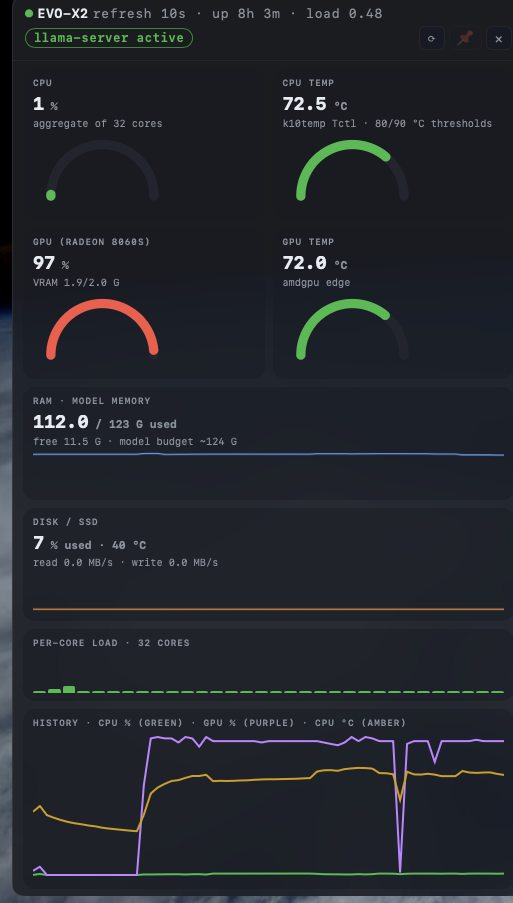

# EVO-X2 Monitor

A live **macOS desktop widget** (plus a terminal dashboard) for the **GMKtec EVO-X2** (Ryzen AI Max+ 395 / Radeon 8060S, 128 GB, Ubuntu 24.04) — the box that hosts our local LLMs.



The widget lives **on the desktop, behind your open apps** — like a native macOS widget — with frosted-glass translucency (the desktop shows through, text and gauges stay crisp). Everything updates live at your chosen refresh rate.

## What it shows

| Card | Metric | Source (on the EVO-X2) |
|---|---|---|
| CPU | utilisation, aggregate of 32 cores | `/proc/stat` delta |
| CPU temp | k10temp `Tctl`, 80/90 °C thresholds | `hwmon temp1` |
| GPU | Radeon 8060S busy %, VRAM used/total | `gpu_busy_percent`, `mem_info_vram_*` |
| GPU temp | amdgpu edge | `hwmon temp1` |
| RAM | used / 123 GiB model budget | `/proc/meminfo` |
| DISK / SSD | root fs %, NVMe temp, read/write MB/s | `statvfs`, `nvme*` hwmon, `/proc/diskstats` |
| NET | down/up MB/s | `/proc/net/dev` delta |
| llama-server | `active` / `inactive` | `systemctl is-active` (never probe `:8080`) |

Plus: per-core load ticks for all 32 cores, a rolling history chart (CPU %, GPU %, CPU °C), uptime and load average, and a `⟳` rate picker (1 / 2 / 5 / 10 / 30 / 60 / 300 s).

## Widget controls

- **Drag** anywhere to move it — position, size and refresh rate are remembered across restarts.
- **⟳** sets the refresh rate (persisted).
- **📌** pins the widget *above* all apps; click again to drop it back to the desktop layer (below your windows).
- **×** quits.

Nothing is ever installed on the EVO-X2: a read-only, stdlib-only collector is **streamed over SSH** into a persistent connection (`ssh … python3 - < bin/collector.py`), and the Mac side serves it locally at `http://127.0.0.1:8765/` (open that URL for a full-size dashboard while the widget runs).

## Quick start (Mac)

```bash
git clone https://github.com/ljawor/EVO-X2-Monitor.git
cd EVO-X2-Monitor
python3 -m venv .venv && .venv/bin/pip install -e .
.venv/bin/python bin/evo_x2_widget.py
```

Requirements: macOS with Python ≥ 3.10 and SSH key access to the box — see `bin/widget_core.py` for the host/user/key (currently `ssh -i ~/.ssh/evo_x2 lukasz@192.168.1.24`). A single-instance guard keeps duplicates out (local port `127.0.0.1:8765`).

## Start it when it's closed

Double-click **EVO X2 Monitor.app** on the Desktop (or in `~/Applications`). It's a thin launcher that runs `bin/evo_x2_widget.py` with the repo venv, so updates in the repo take effect immediately. Rebuild/copy it any time:

```bash
.venv/bin/python bin/make_app.py      # writes build/EVO X2 Monitor.app
```

## Survives restarts (auto-start at login)

Install the LaunchAgent once — macOS launches the widget at every login and relaunches it if it *crashes* (a manual `×` quit stays quit until the next login or a double-click):

```bash
mkdir -p ~/Library/LaunchAgents
cp bin/com.evox2.widget.plist ~/Library/LaunchAgents/
launchctl bootstrap gui/$(id -u) ~/Library/LaunchAgents/com.evox2.widget.plist   # activate now
```

Log file: `~/Library/Logs/evox2-widget.log`.

## Terminal dashboard (no window, pure SSH)

```bash
./bin/evo_x2_monitor.py             # live refresh; --once for a single snapshot
```

## How it works

```
EVO-X2 (Ubuntu)                       Mac
┌──────────────────────┐  SSH stdio   ┌──────────────────────────────┐
│ collector.py         │ ◄─────────── │ widget_core.py               │
│ reads only /proc,    │  streamed,   │  · persistent SSH thread     │
│ /sys, systemctl —    │  never       │  · ThreadingHTTPServer       │
│ nothing installed    │  installed   │    127.0.0.1:8765            │
└──────────────────────┘              │ evo_x2_widget.py (pywebview) │
                                      │  · AppKit level −1: desktop  │
                                      │    layer, below open apps    │
                                      │  · NSVisualEffectView frost  │
                                      │  · geometry autosaved        │
                                      └──────────────────────────────┘
```

Implementation notes:

- **Desktop-layer window**: `CGWindowLevelForKey(kCGNormalWindowLevelKey) − 1` — above the desktop, below every app window, and still clickable (unlike the desktop-icon level, where Finder swallows all mouse events).
- **Frosted glass**: `NSVisualEffectView` under the WKWebView with `NSAppearanceNameDarkAqua`; HTML backgrounds at low alpha so the blur shows through while text stays opaque. (CSS `backdrop-filter` cannot blur what is behind the window — only a real effect view can.)
- **Geometry persistence**: window frame read from Cocoa (bottom-left origin, flipped against the screen that owns the global origin — important on multi-display) and autosaved every 5 s, so even a hard quit keeps your layout. State: `~/.evo-x2-widget.json`.
- **Resilience**: SSH drops retry with backoff; the widget shows the last snapshot plus an error badge while reconnecting.

## Repo layout

```
bin/collector.py            read-only sensor collector (runs on EVO-X2 via SSH stdin)
bin/widget_core.py          SSH stream + local HTTP + history ring (widget backend)
bin/evo_x2_widget.py        pywebview/AppKit desktop widget host
bin/evo_x2_monitor.py       terminal dashboard (rich)
bin/make_app.py             builds the EVO X2 Monitor.app launcher
bin/com.evox2.widget.plist  LaunchAgent for login autostart
web/dashboard.html          dashboard UI (full page + compact widget mode)
docs/PROPOSAL.md            design notes from the terminal-monitor iteration
docs/widget.png             cover screenshot
```

## Known limits

- **GTT / total VRAM** is unavailable on this kernel (`i915 memory_info` debugfs doesn't exist); RAM is the working model-memory proxy.
- The EVO-X2 must be reachable via SSH; while reconnecting the widget keeps showing the last snapshot with an error badge.
